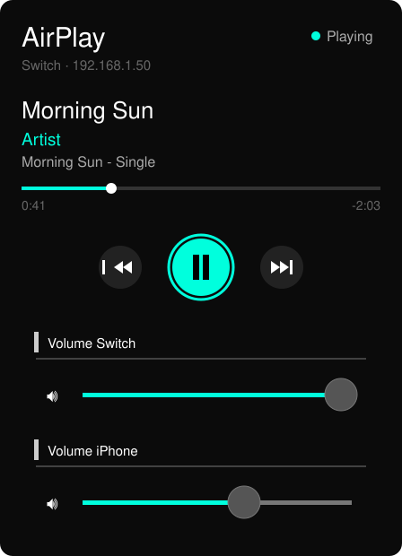
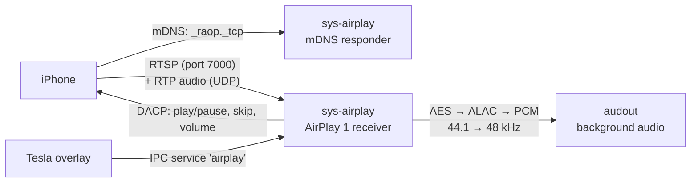

# sys-airplay

**AirPlay receiver for the Nintendo Switch.** Pick "Switch" in the AirPlay menu of any iPhone app
(Apple Music, Podcasts, Spotify, YouTube…) and the sound comes out of the Switch, **in the background while you
play a game**. A Tesla overlay shows the track and lets you pause, skip and change the volume without touching
the phone.

<p align="center"></p>

[](https://github.com/azarucha/sys-airplay/actions/workflows/build.yml)


> **Unofficial hobby project.** Not affiliated with, endorsed by or supported by Nintendo or Apple. Requires a
> Switch running custom firmware (Atmosphère). For personal use. No support, see below.

## Why

There is no Apple Music app for the Switch, and there can't be a homebrew one: Apple Music streams are
DRM-protected. AirPlay sidesteps that. The iPhone keeps playing with your normal subscription and only sends the
audio to the Switch, like it would to any AirPlay speaker. Nothing is decrypted that Apple doesn't hand to every
AirPlay receiver.

## Features

- **Shows up as an AirPlay speaker** on iPhone, iPad and Mac, no app needed on the phone
- **Plays in the background**, also during games (the game's own sound keeps playing)
- **Overlay** (Tesla / Ultrahand): title, artist, album, progress, play/pause, previous, next
- **Two volume sliders**: one for the Switch only (balance music against the game), one that sets the AirPlay
  volume on the iPhone
- The iPhone's volume buttons and the lock screen controls keep working
- Small: about 1.5 MB of system memory, runs on the system core, not on the cores games use

## How it works



1. The sysmodule starts with the console and announces itself on the Wi-Fi as an AirPlay 1 (RAOP) speaker.
2. The iPhone connects over RTSP and streams Apple Lossless audio over RTP. sys-airplay decrypts it with the
   session key, decodes it with Apple's open-source ALAC decoder and plays it through `audout`, next to the game.
3. Title, artist, album and progress arrive as AirPlay metadata.
4. The overlay talks to the sysmodule through an IPC service. Buttons are forwarded to the iPhone through DACP,
   the same remote control protocol the Apple Remote app uses.

## Requirements

- Switch with **Atmosphère**
- **nx-ovlloader** and **Tesla Menu** or **Ultrahand** for the overlay
- iPhone (or iPad/Mac) and Switch in the **same Wi-Fi**. Guest networks and networks with client isolation
  (hotels, trains, universities) usually block AirPlay.

## Installation

Download `sys-airplay.zip` from the [latest release](https://github.com/azarucha/sys-airplay/releases/latest),
unzip it to the root of the SD card and restart the Switch:

```
atmosphere/contents/420000000000A1A7/exefs.nsp
atmosphere/contents/420000000000A1A7/flags/boot2.flag
atmosphere/contents/420000000000A1A7/toolbox.json
switch/.overlays/sys-airplay.ovl
```

With ftpd running on the Switch you can also copy a local build over the network:

```bash
python upload_ftp.py 192.168.1.50 5000
```

## Usage

1. iPhone: Control Center → AirPlay icon → **Switch** (or the AirPlay button in the app's player).
2. Open the overlay menu (default **L + D-pad down + right stick**) → **AirPlay**.
3. Left/right selects a button, A presses it. The buttons also react to touch.

## Settings

`sdmc:/config/sys-airplay/config.ini` is created on first start:

| Key         | Meaning                                                                 |
|-------------|-------------------------------------------------------------------------|
| `name`      | Name in the AirPlay menu (default "Switch")                             |
| `volume`    | Switch volume, 0.0 to 1.0 (the overlay slider changes it too)           |
| `buffer_ms` | Audio buffered before playback starts. Raise to 600 if it stutters      |
| `log`       | 1 = write `sdmc:/config/sys-airplay/log.txt`                            |
| `mac`       | Internal ID of this receiver, don't change                              |

Restart the Switch after editing the file.

## Building

You need [devkitPro](https://github.com/devkitPro/installer/releases) with Switch support, the mbedtls portlib
and Python 3:

```bash
dkp-pacman -S --needed switch-dev switch-mbedtls
python fetch_deps.py
make
```

The SD card layout ends up in `out/`. On Windows, `build.bat` does both steps through devkitPro's MSYS2.

`fetch_deps.py` downloads what isn't in this repository:
[Apple's ALAC decoder](https://github.com/macosforge/alac) (Apache 2.0),
[libtesla](https://github.com/WerWolv/libtesla) (GPLv2) and the publicly known AirPort Express key that every
AirPlay 1 receiver needs, taken from [shairport-sync](https://github.com/mikebrady/shairport-sync)'s source and
checked before use.

## Troubleshooting

- **"sys-airplay is not running" in the overlay**: the overlay can start the sysmodule itself and shows the
  error code and the free system memory.
- **The Switch doesn't show up on the iPhone**: check `log.txt` for "mDNS bereit" and the port line. If both are
  there, the router probably blocks multicast (client isolation / guest mode).
- **Stutters**: raise `buffer_ms`. 5 GHz Wi-Fi helps.

## Limitations

- Classic AirPlay (version 1). The Switch can't join AirPlay 2 multi-room groups in the Home app, but you can
  pick it on its own.
- About 2 seconds of latency. Fine for music and podcasts, video will be ahead of the sound.
- Sleep mode drops the Wi-Fi connection. Pick the Switch again on the iPhone afterwards.
- No cover art.
- Browsing the Apple Music library from the Switch isn't possible: Apple has no interface for AirPlay speakers
  to browse or start content on the phone.

## Support

This is a personal hobby project. Issues and pull requests are welcome, but there's no guarantee of answers or
fixes.

## License

MIT, see [LICENSE](LICENSE). The overlay binary links libtesla and is therefore distributed under GPLv2. The
sysmodule binary contains Apple's ALAC decoder under the Apache License 2.0.
